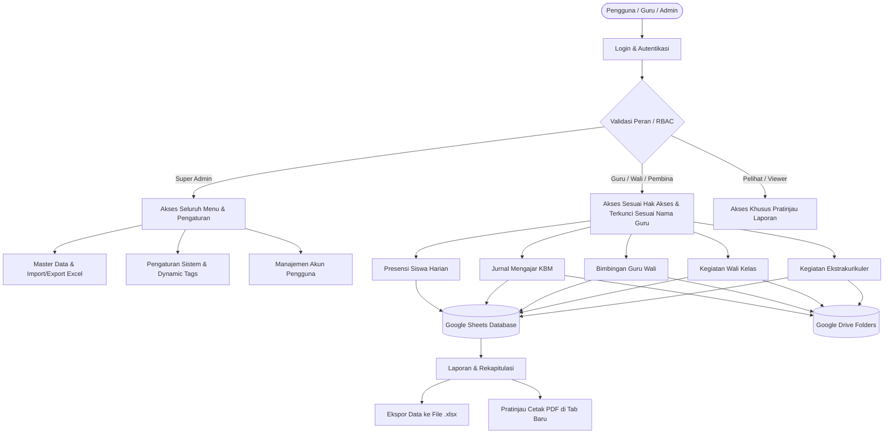

# SIGURU — Sistem Informasi Guru Terpadu

## Berbasis Google Apps Script & Full Google Sheets Database

[](https://script.google.com/)
[](https://docs.google.com/spreadsheets/)
[](https://drive.google.com/)
[](https://getbootstrap.com/)
[](https://sheetjs.com/)

---

## 📖 1. Tentang Aplikasi

**SIGURU** (*Sistem Informasi Guru Terpadu*) adalah platform manajemen administrasi pendidik, jurnal mengajar, presensi siswa, pembinaan kesiswaan, bimbingan guru wali, serta kegiatan ekstrakurikuler yang dibangun menggunakan arsitektur **serverless Google Apps Script** dengan **Google Sheets sebagai basis data relasional** dan **Google Drive sebagai repositori berkas digital**.

Aplikasi ini merupakan transformasi lengkap dari sistem web konvensional (PHP/MySQL) menjadi sistem cloud serverless Google Workspace tanpa memerlukan biaya sewa server hosting maupun database pihak ketiga.

### Fitur Utama

- **Zero-Server & Free-Hosting**: Berjalan langsung di atas infrastruktur Google Cloud melalui Google Apps Script.
- **Full Database Google Sheets**: Seluruh data master, transaksi kegiatan harian, dan log terekam rapi di 11 lembar kerja spreadsheet yang dapat diakses dan diinspeksi langsung oleh admin.
- **Google Drive Storage Integration**: Upload dokumentasi, bukti mengajar, foto profil siswa, logo sekolah, dan tanda tangan digital langsung tersimpan di folder Google Drive terpisah dengan manajemen hapus/ganti otomatis.
- **Ekspor/Impor Excel (.xlsx) Penuh**: Mendukung ekspor data, unduh template, dan impor berkas Microsoft Excel (.xlsx) di seluruh menu Master Data, Pengaturan, dan Laporan menggunakan SheetJS.
- **Cetak Laporan PDF Resmi Tab Baru**: Dilengkapi format Kop Surat Resmi (gambar/teks), orientasi kertas dinamis (Portrait/Landscape), multi-tautan bukti digital aktif, dan tanda tangan proporsional seimbang (Kepala Sekolah & Guru rata tengah).
- **Multi-Role RBAC (Role-Based Access Control)**: Pengaturan hak akses fleksibel dengan fitur kombinasi peran ganda (*multi-role*) dan penguncian filter data otomatis sesuai identitas guru yang sedang login.

---

## 🏛️ 2. Arsitektur & Alur Kerja Sistem (System Workflow)



### Penjelasan Alur Tiap Modul

#### A. Alur Beranda Publik, Autentikasi, Keamanan URL, & Multi-Role RBAC

1. **Beranda Publik Pertama Kali Dibuka ([Landing.html](file:///g:/Download%20File/Coba/Siguru%20Apps%20Script/Landing.html))**:
   - Saat tautan web app pertama kali dibuka tanpa parameter tambahan di peramban, sistem secara otomatis menampilkan **Landing Page** publik terlebih dahulu yang memuat profil sekolah, statistik akademik terkini (jumlah guru, siswa, jurnal KBM, dan ekstra), serta tombol akses menuju portal guru.
2. **Proteksi Akses URL Langsung (Zero-Flicker Guard)**:
   - Jika peramban membuka URL aplikasi dengan parameter menu internal (seperti `?page=form-absen`, `?page=dashboard`, dll.) tanpa memiliki sesi login aktif, pelindung instan di `<head>` ([StyleCSS.html](file:///g:/Download%20File/Coba/Siguru%20Apps%20Script/StyleCSS.html)) langsung **menyembunyikan seluruh tampilan seketika (0 piksel/flicker)** dan me-redirect peramban ke halaman [Login.html](file:///g:/Download%20File/Coba/Siguru%20Apps%20Script/Login.html) disertai pesan peringatan *"Sesi Belum Aktif"*.
   - Target menu awal disimpan sementara di `sessionStorage` (`siguru_redirect_target`), sehingga setelah pengguna berhasil login, sistem langsung mengantarkan pengguna kembali ke menu yang dituju secara mulus (apabila memiliki hak akses).
3. **Proses Masuk (Login)**:
   - Pengguna memasukkan **Username** dan **Password** di halaman [Login.html](file:///g:/Download%20File/Coba/Siguru%20Apps%20Script/Login.html).
   - Server memvalidasi terhadap sheet `Data User`. Kata sandi akun utama `SAdmin` diproteksi secara khusus dan tidak dapat diintip oleh admin biasa.
4. **Penyimpanan Sesi & Pengalihan Cerdas**:
   - Sesi disimpan aman di `localStorage` peramban. Jika sesi valid, pengguna diarahkan ke [Dashboard.html](file:///g:/Download%20File/Coba/Siguru%20Apps%20Script/Dashboard.html) (atau langsung ke [LaporanAbsen.html](file:///g:/Download%20File/Coba/Siguru%20Apps%20Script/LaporanAbsen.html) untuk peran *Pelihat*).
5. **Penegakan Hak Akses Berlapis (RBAC Enforcement)**:
   - Bagi pengguna dengan peran Guru / Wali Kelas / Pembina Ekstra, sistem secara otomatis mengunci (*lock*) pilihan nama guru pada seluruh formulir dan menyaring laporan hanya untuk data milik guru bersangkutan.
   - Jika pengguna dengan hak akses terbatas mencoba mengakses URL yang dilarang (misal akun *Pelihat* mengetikkan `?page=form-absen` atau akun *Guru* mengetikkan `?page=pengaturan`), sistem langsung memblokir akses dan mengembalikannya ke beranda/laporan resmi mereka dengan notifikasi *"Akses Ditolak"*.

#### B. Alur Master Data & Excel (.xlsx)

1. **Master Guru** ([MasterGuru.html](file:///g:/Download%20File/Coba/Siguru%20Apps%20Script/MasterGuru.html)): Mengelola data pendidik, NIP, status kepegawaian, penugasan guru wali, wali kelas, dan pembina ekstra. Bagi pengguna non-Super Admin, nama guru terkunci otomatis pada identitas akun login sendiri. Khusus hak akses Super Admin dapat mengelola dan memilih nama guru secara bebas.
2. **Master Murid** ([MasterMurid.html](file:///g:/Download%20File/Coba/Siguru%20Apps%20Script/MasterMurid.html)): Mengelola data siswa, NISN, kelas, nomor kontak orang tua, dan foto siswa dengan lightbox pratinjau resolusi tinggi.
3. **Master Bimbingan (Guru Wali)** ([MasterBimbingan.html](file:///g:/Download%20File/Coba/Siguru%20Apps%20Script/MasterBimbingan.html)): Pemetaan siswa asuh ke masing-masing guru wali penanggung jawab. 
   - **Penguncian Nama Guru Otomatis Sesuai Hak Akses**: Pada filter tabel dan form modal (tambah/edit/impor), nama guru wali otomatis terisi dan terkunci (*read-only* & *disabled*) sesuai akun guru yang sedang login. Guru wali hanya dapat melihat dan mengelola siswa binaan mereka sendiri.
   - **Hak Akses Istimewa Super Admin**: Khusus Super Admin yang dapat memilih nama guru wali dari daftar dropdown secara leluasa untuk keperluan pemetaan dan pengelolaan lintas guru.
4. **Master Ekstrakurikuler** ([MasterEkstra.html](file:///g:/Download%20File/Coba/Siguru%20Apps%20Script/MasterEkstra.html)): Pemetaan anggota kegiatan ekstra ke cabang dan pembina terkait.
5. **Excel Engine**: Setiap halaman master data menyediakan tombol **Unduh Template (.xlsx)**, **Import Excel (.xlsx)**, dan **Export Excel (.xlsx)**. Impor data pada Master Bimbingan bagi guru non-Super Admin otomatis mengaitkan data ke nama guru yang bersangkutan.

#### C. Alur Formulir Harian & Upload Berkas

1. **Presensi Siswa** ([FormAbsen.html](file:///g:/Download%20File/Coba/Siguru%20Apps%20Script/FormAbsen.html)):
   - Memilih Kelas, Mapel, dan Tanggal.
   - Mengisi status presensi siswa per baris dengan segmented buttons: 🟢 Hadir (H), 🟡 Izin (I), 🔵 Sakit (S), 🔴 Alpha (A), dan 🟣 Dispensasi (D).
   - Dilengkapi tombol cepat *Tandai Semua Hadir*. Koreksi presensi pada kelas/mapel/hari yang sama otomatis menimpa rekaman lama agar data tidak ganda.
2. **Jurnal Mengajar KBM** ([FormJurnal.html](file:///g:/Download%20File/Coba/Siguru%20Apps%20Script/FormJurnal.html)):
   - Menghitung nomor *Pertemuan Ke-* secara otomatis berdasarkan riwayat sebelumnya.
   - Pilihan Model/Metode Pembelajaran dan Ketuntasan Materi yang dapat dipilih maupun diketik manual.
   - Mengunggah berkas/foto bukti KBM langsung ke folder Google Drive Jurnal.
3. **Bimbingan Guru Wali** ([FormGuruWali.html](file:///g:/Download%20File/Coba/Siguru%20Apps%20Script/FormGuruWali.html)):
   - Memilih siswa asuh binaan dari daftar yang sesuai dengan guru wali penanggung jawab.
   - Mengisi topik permasalahan dan tindak lanjut, serta tombol langsung chat WhatsApp ke wali murid (`wa.me`).
4. **Kegiatan Wali Kelas & Ekstrakurikuler** ([FormWali.html](file:///g:/Download%20File/Coba/Siguru%20Apps%20Script/FormWali.html) & [FormEkstra.html](file:///g:/Download%20File/Coba/Siguru%20Apps%20Script/FormEkstra.html)):
   - Pencatatan pembinaan kelas dan agenda latihan ekstrakurikuler beserta dokumentasi Drive.

#### D. Alur Laporan, Manajemen Data, & Pembersihan Berkas Drive

1. Seluruh transaksi terekam pada lembar laporan masing-masing: [LaporanAbsen.html](file:///g:/Download%20File/Coba/Siguru%20Apps%20Script/LaporanAbsen.html), [LaporanJurnal.html](file:///g:/Download%20File/Coba/Siguru%20Apps%20Script/LaporanJurnal.html), [LaporanGuruWali.html](file:///g:/Download%20File/Coba/Siguru%20Apps%20Script/LaporanGuruWali.html), [LaporanWali.html](file:///g:/Download%20File/Coba/Siguru%20Apps%20Script/LaporanWali.html), dan [LaporanEkstra.html](file:///g:/Download%20File/Coba/Siguru%20Apps%20Script/LaporanEkstra.html).
2. **Aksi Edit & Hapus**: Pemilik data atau Super Admin dapat mengedit catatan atau menghapusnya.
3. **Otomasi Bersih Drive**: Saat berkas bukti diganti dengan berkas baru atau baris data dihapus, sistem di [Code.gs](file:///g:/Download%20File/Coba/Siguru%20Apps%20Script/Code.gs) otomatis menghapus berkas lama di Google Drive agar kuota penyimpanan tidak membengkak.

#### E. Alur Pratinjau & Cetak PDF Resmi ([PrintLaporan.html](file:///g:/Download%20File/Coba/Siguru%20Apps%20Script/PrintLaporan.html))

1. Tombol **Cetak PDF** di seluruh halaman laporan membuka tab baru pada browser secara instan membawa parameter filter.
2. **Kop Surat Resmi**: Mengambil data kop resmi dari Pengaturan (mendukung gambar kop surat penuh atau susunan teks logo resmi tanpa garis bawah ganda yang mengganggu).
3. **Multi-Link Bukti**: Tautan berkas bukti digital ditampilkan dalam bentuk link aktif yang dapat langsung diklik oleh pemeriksa/pengawas.
4. **Format Tanda Tangan**:
   - Untuk Laporan Umum (*Jurnal*, *Bimbingan*, *Wali Kelas*, *Ekstra*): Tanda tangan 2 kolom seimbang (Kepala Sekolah di sebelah kiri dan Guru/Pembina di sebelah kanan, masing-masing rata tengah di dalam bloknya).
   - Untuk Laporan Presensi Siswa: Tanda tangan tunggal Guru Pengampu/Wali Kelas rata kiri tanpa tanda tangan Kepala Sekolah.

#### F. Alur Tombol Sakti: Pembersihan Database Berkala (Hapus Data)

Pada menu [Pengaturan.html](file:///g:/Download%20File/Coba/Siguru%20Apps%20Script/Pengaturan.html), tersedia fitur **"Tombol Sakti: Pembersihan Database"** yang dirancang untuk mereset sistem saat pergantian periode tahun ajaran baru:

1. **Pembersihan Berkas Digital Google Drive**: Seluruh file lampiran (foto siswa, modul ajar/RPP, bukti konseling, dokumentasi wali kelas, dan latihan ekstra) yang terhubung dengan data **otomatis dihapus dari Google Drive** (dipindahkan ke trash) sehingga tidak membebani ruang penyimpanan. File template bawaan sistem tetap dilindungi.
2. **Pengosongan Transaksi & Master Data**: Mengosongkan seluruh baris pada lembar presensi, jurnal, bimbingan, wali kelas, ekstra, serta master data siswa dan guru.
3. **Proteksi Manajemen User & RBAC**: Akun dengan hak akses **Super Admin** (seperti `SAdmin`) dan **Pelihat** (seperti `viewer`) **TIDAK DIHAPUS**, sehingga hak akses pengelola sistem tetap utuh.
4. **Pemulihan Otomatis Data Pengaturan Default**: Data **Identitas Sekolah & Periode Akademik**, **Kop Surat & Tanda Tangan Digital**, serta **Folder Penyimpanan Google Drive** secara otomatis **disimpan kembali ke nilai defaultnya** di database sheet `Pengaturan`.

---

## 📁 3. Struktur Berkas Proyek

```text
Siguru Apps Script/
├── Code.gs                   # Backend API: Handler Google Sheets, DriveApp, Auth, & CRUD
├── appsscript.json           # Konfigurasi manifest Google Apps Script & perizinan OAuth
├── DEPLOYMENT_GUIDE.md       # Panduan langkah deployment ke production Google Apps Script
├── Readme.md                 # Dokumentasi komprehensif struktur, alur, konfigurasi & panduan
│
├── StyleCSS.html             # Desain global, variabel warna, responsivitas, dan stylesheet komponen
├── Sidebar.html              # Navigasi sidebar dinamis berdasarkan peran pengguna
├── Header.html               # Header atas: auto-hiding navbar, jam real-time, tombol cache, profil
├── AppJS.html                # Pustaka utilitas client: auth, cache, format tanggal, Excel engine
│
├── Landing.html              # Halaman beranda publik & informasi sekolah
├── Login.html                # Formulir autentikasi pengguna & validasi sesi
├── Dashboard.html            # Dashboard utama: statistik metrik, ringkasan KBM, & grafik
├── Profil.html               # Pengaturan profil pengguna yang sedang login & ganti kata sandi
│
├── MasterGuru.html           # Master Data Pendidik & Tenaga Kependidikan (Excel I/O)
├── MasterMurid.html          # Master Data Siswa & Foto Siswa (Excel I/O)
├── MasterBimbingan.html      # Master Pemetaan Siswa Asuh Guru Wali (Excel I/O)
├── MasterEkstra.html         # Master Anggota & Cabang Ekstrakurikuler (Excel I/O)
│
├── FormAbsen.html            # Formulir Pencatatan Presensi Siswa Harian
├── FormJurnal.html           # Formulir Jurnal Mengajar Harian Guru (KBM)
├── FormGuruWali.html         # Formulir Catatan Bimbingan Siswa Asuh
├── FormWali.html             # Formulir Catatan Kegiatan Wali Kelas
├── FormEkstra.html           # Formulir Catatan Kegiatan Ekstrakurikuler
│
├── LaporanAbsen.html         # Laporan Presensi: Rekap Persentase & Log Harian
├── LaporanJurnal.html        # Laporan Jurnal Mengajar & Analisis Efektivitas KBM
├── LaporanGuruWali.html      # Laporan Riwayat Bimbingan Siswa Asuh Guru Wali
├── LaporanWali.html          # Laporan Pembinaan Kegiatan Wali Kelas
├── LaporanEkstra.html        # Laporan Keterlaksanaan Kegiatan Ekstrakurikuler
│
├── PrintLaporan.html         # Template Cetak Laporan PDF Resmi Tab Baru
├── Pengaturan.html           # Pengaturan Sistem: Profil Sekolah, Tag Manager, Excel I/O, Reset Data
└── UserManagement.html       # Pengelolaan Akun Pengguna & Hak Akses (Role Management)
```

---

## 🗄️ 4. Struktur Basis Data (Google Sheets)

Database utama disimpan pada Google Spreadsheet dengan 11 Sheet terstruktur:

| No | Nama Sheet | Deskripsi & Field Utama |
| --- | --- | --- |
| 1 | `Pengaturan` | Pengaturan sekolah, nama instansi, logo, link kop surat, TTD kepsek, list Tahun Ajaran, Kelas, Mapel, Ekstra |
| 2 | `Data User` | Data kredensial pengguna (`id`, `username`, `password`, `nama`, `role`, `nip`) |
| 3 | `Data Guru` | Master data guru (`id`, `nip`, `nama_guru`, `jenis_kelamin`, `mapel_diampu`, `no_wa`) |
| 4 | `Data Murid` | Master data siswa (`id`, `nisn`, `nama_murid`, `jenis_kelamin`, `kelas`, `no_wa_ortu`, `foto_siswa`, dll.) |
| 5 | `Data Murid Guru Wali` | Relasi siswa bimbingan (`id`, `nama_murid`, `kelas`, `guru_wali`, `kontak`) |
| 6 | `Data Murid Ekstra` | Relasi siswa ekstra (`id`, `nama_murid`, `kelas`, `kegiatan_ekstra`, `pembina`) |
| 7 | `Hasil Absen` | Log presensi harian siswa (`id`, `tanggal`, `tahun_ajaran`, `semester`, `kelas`, `mapel`, `guru`, `nisn`, `nama_murid`, `keterangan`) |
| 8 | `Hasil Jurnal` | Catatan KBM guru (`id`, `tanggal`, `tahun_ajaran`, `semester`, `kelas`, `mapel`, `guru`, `pertemuan_ke`, `materi`, `tuntas`, `link_bukti`) |
| 9 | `Hasil Guru Wali` | Riwayat konseling (`id`, `tanggal`, `tahun_ajaran`, `semester`, `guru_wali`, `nama_murid`, `topik`, `tindak_lanjut`, `file_bukti`) |
| 10 | `Hasil Wali` | Agenda kegiatan wali kelas (`id`, `tanggal`, `tahun_ajaran`, `semester`, `wali_kelas`, `deskripsi`, `link_bukti`) |
| 11 | `Hasil Ekstra` | Agenda kegiatan ekstra (`id`, `tanggal`, `tahun_ajaran`, `semester`, `pembina`, `cabang`, `peserta`, `keterangan`, `link_bukti`) |

---

## 📂 5. Repositori Berkas Digital (Google Drive Folders)

Setiap lampiran berkas yang diunggah disimpan pada folder Google Drive masing-masing untuk menjaga kerapian data:

1. **Folder Jurnal Mengajar**: Penyimpanan foto/dokumen RPP, modul ajar, dan foto pelaksanaan KBM.
2. **Folder Foto Siswa / Logo / TTD**: Penyimpanan pas foto siswa, gambar logo sekolah, dan tanda tangan digital.
3. **Folder Bimbingan Guru Wali**: Penyimpanan dokumentasi sesi konseling siswa asuh.
4. **Folder Kegiatan Wali Kelas**: Penyimpanan arsip notula pertemuan paguyuban dan pembinaan kelas.
5. **Folder Kegiatan Ekstrakurikuler**: Penyimpanan dokumentasi latihan dan kegiatan lomba ekstra.

---

## 🔐 6. Hak Akses & Kredensial Default

| Username | Password Default | Peran (Role) | Hak Akses |
| --- | --- | --- | --- |
| **`SAdmin`** | `Pengelola@Admin@Super` | **Super Admin** | Hak akses tertinggi ke seluruh menu, pengaturan sistem, database, dan manajemen akun. Akun dilindungi secara permanen dari penghapusan atau pergantian username. |
| **`viewer`** | `view123` | **Pelihat (Viewer)** | Akses baca saja (*read-only*) untuk pratinjau dan pencetakan laporan tanpa izin modifikasi data. |
| *Akun Guru* | *Dibuat oleh Admin* | **Guru / Wali / Pembina** | Akses ke modul operasional harian dengan filter otomatis terkunci pada nama guru masing-masing. |

---

## 🛠️ 7. Panduan Penerapan di Spreadsheet Lain (Multi-Tenancy / Setup Baru)

Jika Anda ingin menerapkan kode aplikasi SIGURU ini untuk **sekolah lain, cabang baru, atau Google Spreadsheet lain**, berikut adalah panduan lengkap titik konfigurasi dan penempatannya:

### A. Titik Konfigurasi Utama di Kode Backend ([Code.gs](file:///g:/Download%20File/Coba/Siguru%20Apps%20Script/Code.gs))

Hanya ada **1 (satu) baris kode utama** yang wajib diubah di [Code.gs](file:///g:/Download%20File/Coba/Siguru%20Apps%20Script/Code.gs) baris ke-7:

```javascript
// Lokasi: Code.gs (Baris 7)
const SPREADSHEET_ID = '1QflTpQGL0wwTq-rvu8u__Qzu5fByt3SVrno2vjiX7Zo';
```

**Cara Mendapatkan SPREADSHEET_ID Baru**:

1. Buat Google Spreadsheet baru di Google Drive Anda.
2. Perhatikan URL di bilah alamat peramban:
   `https://docs.google.com/spreadsheets/d/`**`[ID_SPREADSHEET_BARU]`**`/edit`
3. Salin kode karakter panjang yang berada di antara `/d/` dan `/edit`.
4. Tempelkan menggantikan nilai `SPREADSHEET_ID` di baris 7 [Code.gs](file:///g:/Download%20File/Coba/Siguru%20Apps%20Script/Code.gs).

> [!NOTE]
> **Inisialisasi Otomatis (Zero Setup)**:
> Anda **TIDAK PERLU** membuat tabel atau nama-nama sheet secara manual di spreadsheet baru! Saat Web App pertama kali dibuka, skrip secara otomatis mendeteksi spreadsheet kosong dan langsung membuat seluruh 11 Sheet (`Pengaturan`, `Data User`, `Data Guru`, dsb.) lengkap beserta baris header kolomnya.

---

### B. Menyiapkan Folder Penyimpanan di Google Drive

Aplikasi membutuhkan 5 folder terpisah di Google Drive untuk memisahkan berkas unggahan:

1. Buat folder induk di Google Drive Anda, misalnya: `SIGURU_[Nama_Sekolah]`.
2. Di dalam folder induk tersebut, buat 5 subfolder:
   - `01_Berkas_Jurnal` *(untuk bukti KBM guru)*
   - `02_Foto_Logo_TTD` *(untuk foto siswa, logo instansi, dan ttd kepsek)*
   - `03_Berkas_Bimbingan` *(untuk dokumentasi konseling guru wali)*
   - `04_Berkas_Wali_Kelas` *(untuk dokumentasi kegiatan wali kelas)*
   - `05_Berkas_Ekstrakurikuler` *(untuk dokumentasi kegiatan ekstra)*
3. Dapatkan tautan/URL masing-masing folder:
   - Klik kanan folder > **Bagikan (Share)** > pilih **Siapa saja yang memiliki tautan (Anyone with the link) sebagai Pelihat (Viewer)**.
   - Klik **Salin Tautan (Copy Link)**.
   - Format link folder: `https://drive.google.com/drive/folders/`**`[ID_FOLDER_DRIVE]`**`?usp=sharing`.

---

### C. Konfigurasi Melalui Menu Pengaturan Sistem (Tanpa Menyentuh Kode)

Setelah `SPREADSHEET_ID` diatur dan Web App dideploy, seluruh konfigurasi aset visual dan folder Drive **dapat diatur langsung melalui antarmuka web**:

- Buka Web App SIGURU, lalu login sebagai **`SAdmin`**.
- Masuk ke menu **Pengaturan Sistem** ([Pengaturan.html](file:///g:/Download%20File/Coba/Siguru%20Apps%20Script/Pengaturan.html)).
- Masukkan data ke kolom-kolom yang tersedia sesuai panduan tabel berikut:

| Item Pengaturan | Cara Pengisian & Penempatan di Antarmuka | Keterangan |
| --- | --- | --- |
| **Folder Drive Jurnal** | Masukkan URL folder `01_Berkas_Jurnal` | Tempat penyimpanan bukti KBM |
| **Folder Drive Foto Siswa / Logo** | Masukkan URL folder `02_Foto_Logo_TTD` | Tempat penyimpanan foto siswa & logo |
| **Folder Drive Bimbingan Guru Wali** | Masukkan URL folder `03_Berkas_Bimbingan` | Tempat penyimpanan berkas bimbingan |
| **Folder Drive Kegiatan Wali Kelas** | Masukkan URL folder `04_Berkas_Wali_Kelas` | Tempat penyimpanan berkas wali kelas |
| **Folder Drive Ekstrakurikuler** | Masukkan URL folder `05_Berkas_Ekstrakurikuler` | Tempat penyimpanan berkas ekstra |
| **Logo Sekolah** | Masukkan URL thumbnail gambar atau klik tombol upload | Muncul di Kop Surat teks dan Header |
| **Gambar Kop Surat Resmi** | Masukkan URL gambar kop surat atau klik tombol upload | Banner kop resmi di pratinjau cetak PDF |
| **TTD Kepala Sekolah** | Masukkan URL gambar tanda tangan atau klik tombol upload | Muncul di kolom tanda tangan kiri cetak PDF |
| **Identitas Sekolah & Tag** | Isi Nama Sekolah, Kepsek, NIP, Kabupaten, TA, Kelas, Mapel | Digunakan pada seluruh filter & header |

- Klik tombol **Simpan Pengaturan**. Nilai-nilai ini langsung disimpan ke sheet `Pengaturan` di Google Spreadsheet baru Anda.

---

### D. Nilai Fallback Default di [Code.gs](file:///g:/Download%20File/Coba/Siguru%20Apps%20Script/Code.gs) (Opsional)

Jika Anda ingin mendistribusikan kode dengan nilai default yang langsung terisi bahkan sebelum pengguna menyimpan data di menu Pengaturan, Anda dapat menyesuaikan objek `return` pada fungsi `getSettings()` di [Code.gs](file:///g:/Download%20File/Coba/Siguru%20Apps%20Script/Code.gs#L303-L325):

```javascript
// Lokasi: Code.gs (Baris 303 - 325)
function getSettings() {
  const data = getSheetData(SHEET_NAMES.PENGATURAN);
  if (data.length > 0) return data[0];
  
  // Nilai Fallback Default jika sheet Pengaturan masih kosong:
  return {
    id: 1,
    logo: 'URL_LOGO_DEFAULT_ANDA',
    nama_sekolah: 'NAMA SEKOLAH BARU',
    tahun_ajaran: '2026/2027',
    list_tahun_ajaran: '["2025/2026", "2026/2027", "2027/2028"]',
    semester: 'Ganjil',
    kelas: 'X A, X B, XI A, XI B, XII A, XII B',
    mata_pelajaran: 'Matematika, Bahasa Indonesia, Bahasa Inggris',
    folder_jurnal: 'URL_FOLDER_JURNAL_DRIVE_ANDA',
    folder_foto: 'URL_FOLDER_FOTO_DRIVE_ANDA',
    folder_guru_wali: 'URL_FOLDER_GURU_WALI_DRIVE_ANDA',
    folder_wali: 'URL_FOLDER_WALI_DRIVE_ANDA',
    folder_ekstra: 'URL_FOLDER_EKSTRA_DRIVE_ANDA',
    list_ekstrakurikuler: 'Pramuka, Paskibra, Futsal, PMR',
    kepala_sekolah: 'Nama Kepala Sekolah, M.Pd.',
    nip_kepala_sekolah: '19750101 200001 1 001',
    kop_surat: 'URL_GAMBAR_KOP_SURAT_DEFAULT_ANDA',
    kop_size: '90',
    kabupaten: 'Nama Kabupaten',
    ttd_kepsek: 'URL_TTD_KEPSEK_DEFAULT_ANDA'
  };
}
```

---

## 📌 8. Aturan Pemeliharaan Dokumen (Maintenance Guidelines)

> [!IMPORTANT]
> **Komitmen Pembaruan Terus-Menerus**:
> Setiap kali terdapat penambahan fitur, perubahan fungsi, perubahan alur navigasi, atau penyesuaian struktur database dan tata letak cetak, berkas **`DEPLOYMENT_GUIDE.md`** dan **`Readme.md`** **WAJIB** diperbarui secara sinkron agar dokumentasi selalu mencerminkan kondisi kode terkini secara akurat.
