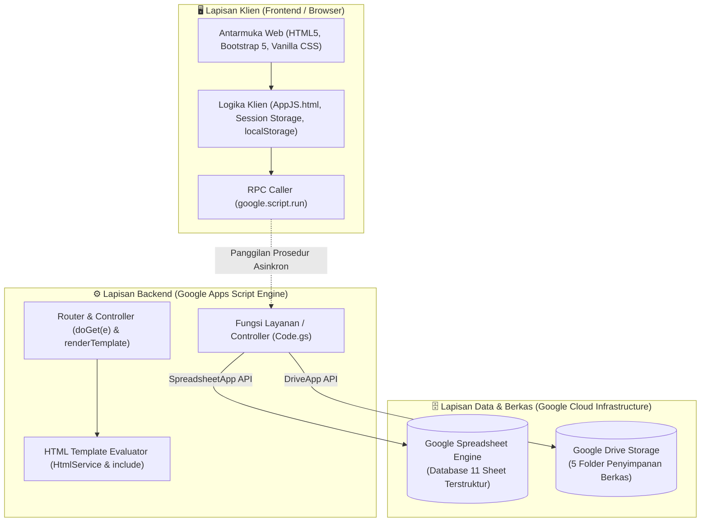
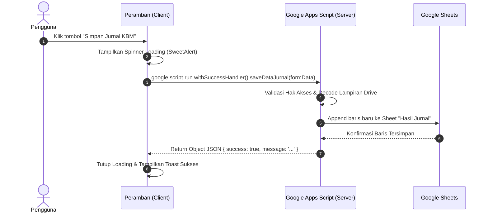

# ARSITEKTUR & TEKNIK PEMBUATAN WEB APLIKASI SIGURU

Sistem Informasi Guru Terpadu Berbasis Google Apps Script & Google Sheets Database.

---

[](Readme.md)
[](DEPLOYMENT_GUIDE.md)
[](Teknik%20pembuatan.md)
[](SECURITY.md)
[](LICENSE)

---

## 📚 Navigasi Dokumentasi Repositori

- 📖 **[Readme Utama (README.md)](Readme.md)**: Ikhtisar sistem, alur modul, dan hak akses.
- 🚀 **[Panduan Deployment (DEPLOYMENT_GUIDE.md)](DEPLOYMENT_GUIDE.md)**: Panduan instalasi Google Apps Script & setup spreadsheet.
- 🏛️ **[Arsitektur & Teknik Pembuatan (Teknik pembuatan.md)](Teknik%20pembuatan.md)**: Arsitektur SPA, Google Sheets database, dan SheetJS.
- 🛡️ **[Kebijakan Keamanan (SECURITY.md)](SECURITY.md)**: Standar keamanan sistem dan pelaporan kerentanan.
- ⚖️ **[Lisensi Resmi (LICENSE)](LICENSE)**: Ketentuan lisensi perangkat lunak MIT.

---

## 📌 1. Nama & Klasifikasi Teknik Arsitektur

Secara baku dalam rekayasa perangkat lunak web, teknik dan arsitektur yang digunakan dalam pembuatan aplikasi ini diklasifikasikan sebagai:

1. **Google Apps Script HTML Service — Server-Side Template Inclusion (Scriptlet Pattern)**
2. **Multi-Page Serverless Web Application (MPA) berbasis Query Parameter Routing**
3. **BaaS (Backend-as-a-Service) & Spreadsheet-Driven Database Architecture**
4. **Asynchronous Remote Procedure Call (RPC) Client-Server Communication**

---

## 🏗️ 2. Gambaran Umum Arsitektur Sistem

Aplikasi ini dibangun tanpa menggunakan server fisik (VPS), tanpa hosting berbayar (cPanel/Cloud Hosting), dan tanpa database engine SQL konvensional (MySQL/PostgreSQL). Seluruh komponen berjalan 100% di atas infrastruktur **Google Cloud Platform (GCP)** secara serverless:



---

## 🧩 3. Bedah Teknik - Mengapa Setiap Halaman Berupa 1 File HTML Utuh

Saat membuka berkas seperti `FormJurnal.html`, `Dashboard.html`, `Profil.html`, atau `MasterMurid.html`, setiap berkas terlihat memiliki kerangka dokumen lengkap (`<!DOCTYPE html>`, `<html>`, `<head>`, `<body>`).

Hal ini merupakan implementasi dari **Server-Side Template Inclusion (Scriptlet Inclusion)** bawaan Google Apps Script:

### A. Tag Scriptlet Pemanggil

Di dalam setiap file HTML, komponen bersama (*shared components*) tidak ditulis ulang berkali-kali, melainkan dipanggil menggunakan tag scriptlet:

```html
<!DOCTYPE html>
<html lang="id">
<head>
  <meta charset="UTF-8">
  <title>Jurnal Mengajar Guru - SIGURU</title>
  <?!= include('StyleCSS'); ?>   <!-- 1. Injeksi Stylesheet Global -->
</head>
<body>
  <?!= include('Sidebar'); ?>    <!-- 2. Injeksi Navigasi Sidebar Dinamis -->
  <?!= include('Header'); ?>     <!-- 3. Injeksi Navbar Atas & Avatar -->
  
  <main class="content-wrapper">
    <!-- Konten Spesifik Halaman Ini -->
  </main>

  <?!= include('AppJS'); ?>      <!-- 4. Injeksi Pustaka Logika Client Global -->
</body>
</html>
```

### B. Cara Kerja Scriptlet Google Apps Script

Google Apps Script memiliki 3 jenis scriptlet penulisan:

| Simbol | Tipe Scriptlet | Fungsi & Perilaku | Contoh Penggunaan |
| :--- | :--- | :--- | :--- |
| `<?!= ... ?>` | **Force-Printing Scriptlet (Unescaped)** | Mengeksekusi kode dan mencetak hasilnya secara mentah tanpa HTML encoding. Sangat tepat untuk menyisipkan blok kode HTML/CSS/JS dari file lain. | `<?!= include('Header'); ?>` |
| `<?= ... ?>` | **Printing Scriptlet (Escaped)** | Mengeksekusi kode dan mencetak hasilnya dengan sanitasi HTML (mencegah XSS). | `<?= user.nama ?>` |
| `<? ... ?>` | **Code Scriptlet (Logic Only)** | Menjalankan logika kontrol (kondisional `if/else`, perulangan `for`) di server tanpa mencetak teks langsung. | `<? if (role === 'Admin') { ?>` |

### C. Mesin Inklusi di Backend Code.gs

Fungsi `include()` di [Code.gs](file:///g:/Download%20File/Coba/Siguru%20Apps%20Script/Code.gs) bertindak sebagai *compiler*:

```javascript
// Di dalam Code.gs
function include(filename, data) {
  var t = HtmlService.createTemplateFromFile(filename);
  t.currentPage = _activePage;
  t.params = _activeParams;
  if (data && typeof data === 'object') {
    for (const k in data) t[k] = data[k];
  }
  return t.evaluate().getContent();
}
```

1. `HtmlService.createTemplateFromFile(filename)` membaca berkas HTML komponen dari proyek.
2. `t.evaluate().getContent()` mengevaluasi scriptlet di dalamnya dan mengubahnya menjadi untaian teks HTML statis.
3. Hasilnya disuntikkan secara mulus ke berkas induk sebelum halaman final dikirim ke browser pengguna.

---

## 🚦 4. Mekanisme Routing - Multi-Page Berbasis URL Parameter

Google Apps Script hanya memiliki **1 URL induk (Endpoint Tunggal)** untuk Web App yang dideploy. Untuk menyajikan banyak halaman (*Multi-Page Application*), digunakan teknik **Query Parameter Routing**:

```javascript
// Di dalam Code.gs
function doGet(e) {
  try {
    var page = (e && e.parameter && e.parameter.page) || 'landing';
    _activePage = page;
    _activeParams = e && e.parameter ? e.parameter : {};

    // Peta Rute URL ke File HTML
    var routeMap = {
      'landing': 'Landing',
      'login': 'Login',
      'dashboard': 'Dashboard',
      'profil': 'Profil',
      'master-guru': 'MasterGuru',
      'master-murid': 'MasterMurid',
      'master-bimbingan': 'MasterBimbingan',
      'master-ekstra': 'MasterEkstra',
      'form-absen': 'FormAbsen',
      'form-jurnal': 'FormJurnal',
      'form-guruwali': 'FormGuruWali',
      'form-wali': 'FormWali',
      'form-ekstra': 'FormEkstra',
      'laporan-absen': 'LaporanAbsen',
      'laporan-jurnal': 'LaporanJurnal',
      'laporan-guruwali': 'LaporanGuruWali',
      'laporan-wali': 'LaporanWali',
      'laporan-ekstra': 'LaporanEkstra',
      'pengaturan': 'Pengaturan',
      'user-management': 'UserManagement',
      'print-laporan': 'PrintLaporan'
    };

    var pageFile = routeMap[page] || 'Landing';
    return renderTemplate(pageFile);
  } catch (err) {
    return HtmlService.createHtmlOutput('<h3>Terjadi Kesalahan: ' + err.message + '</h3>');
  }
}
```

### Navigasi di Sisi Browser

Pada antarmuka pengguna, navigasi antar halaman dipicu menggunakan fungsi utilitas di [AppJS.html](file:///g:/Download%20File/Coba/Siguru%20Apps%20Script/AppJS.html):

```javascript
function navigateTo(page, params) {
  var url = getAppUrl() + '?page=' + encodeURIComponent(page);
  if (params && typeof params === 'object') {
    for (var k in params) {
      if (params.hasOwnProperty(k)) {
        url += '&' + encodeURIComponent(k) + '=' + encodeURIComponent(params[k]);
      }
    }
  }
  window.location.href = url;
}
```

---

## ⚡ 5. Komunikasi Klien-Server - Remote Procedure Call

Berbeda dengan aplikasi web biasa yang memanggil API menggunakan `fetch('/api/data')` atau `axios.post()`, Google Apps Script menyediakan mekanisme bawaan bernama **`google.script.run`** (Remote Procedure Call):

### Alur Kerja



### Contoh Kode di Sisi Klien

```javascript
// Memanggil fungsi server langsung seperti memanggil fungsi lokal JavaScript
showLoading('Menyimpan data...');
google.script.run
  .withSuccessHandler(function(response) {
    Swal.close();
    if (response.success) {
      showToast('success', response.message);
      loadTableData();
    } else {
      showToast('error', response.message);
    }
  })
  .withFailureHandler(function(error) {
    Swal.close();
    showToast('error', 'Gagal terhubung ke server: ' + error.message);
  })
  .updateProfil(payload);
```

---

## 🗄️ 6. Basis Data - Google Spreadsheet sebagai Relational/NoSQL Engine

Google Sheets difungsikan layaknya tabel database relasional:

1. **Sheet sebagai Tabel**: Masing-masing dari 11 Sheet (`Pengaturan`, `Data User`, `Data Guru`, `Data Murid`, dsb.) bertindak sebagai tabel independen.
2. **Baris 1 sebagai Skema Header**: Mendefinisikan kolom atribut data (`id`, `nama`, `nip`, `foto`, dll.).
3. **Baris 2 ke Bawah sebagai Rekaman Data (Rows)**.
4. **Fungsi ORM / DAO Buatan Sendiri di [Code.gs](file:///g:/Download%20File/Coba/Siguru%20Apps%20Script/Code.gs)**:
   - `getSheetData(sheetName)`: Membaca range data dan mengonversinya menjadi array of objects JavaScript (`[{id: 1, nama: '...'}, ...]`).
   - `getNextId(sheetName)`: Menghitung ID auto-increment terbesar + 1.
   - `ensureUserFotoColumn()`: Memastikan integritas skema tabel secara dinamis jika kolom baru ditambahkan.

---

## 📁 7. Repositori Berkas - Google Drive sebagai Object Storage

Untuk berkas digital (foto siswa, modul ajar, foto profil, bukti KBM), berkas tidak disimpan sebagai teks di database, melainkan diunggah ke Google Drive:

1. **Pengunggahan via Base64**:
   - Browser membaca berkas melalui `FileReader.readAsDataURL(file)`.
   - Data dipotong menjadi Base64 murni dan dikirim ke fungsi `uploadFileToDrive()`.

2. **Konversi Blob di Server**:

   ```javascript
   const decoded = Utilities.base64Decode(fileData);
   const blob = Utilities.newBlob(decoded, mimeType, fileName);
   const file = targetFolder.createFile(blob);
   ```

3. **Pembuatan Tautan Thumbnail Cepat Bebas CORS**:
   - Google Drive menghasilkan URL thumbnail resolusi tinggi:
     `https://drive.google.com/thumbnail?id=[FILE_ID]&sz=w1000`
   - Format ini dapat dirender langsung pada tag `` di browser klien tanpa kendala blokir CORS atau redirect login Google.

4. **Siklus Bersih Otomatis (*Auto-Trash*)**:
   - Saat foto atau berkas lampiran diganti/dihapus, server melacak file ID lamanya dan memindahkannya ke tempat sampah (`file.setTrashed(true)`) agar kuota penyimpanan Google Drive tetap hemat.

---

## 🛡️ 8. Sistem Keamanan & Autentikasi - Two-Tier RBAC & Zero-Flicker Guard

Aplikasi mengamankan akses data melalui dua tingkat pengamanan:

1. **Zero-Flicker URL Guard di `<head>` ([StyleCSS.html](file:///g:/Download%20File/Coba/Siguru%20Apps%20Script/StyleCSS.html))**:
   - Sebelum peramban selesai merender halaman HTML, skrip di `<head>` langsung memeriksa status sesi di `localStorage`.
   - Jika pengguna belum login atau mencoba membuka menu yang dilarang (misal akun *Guru* mengetik `?page=pengaturan`), seluruh layar langsung disembunyikan seketika (0 piksel terlihat) dan dialihkan (*redirect*) ke halaman Login atau Dashboard.
2. **Server-Side Data Scoping**:
   - Saat fungsi server dipanggil, server memfilter data transaksi sesuai guru yang login. Guru hanya menerima data siswa binaannya atau kelas yang diampunya.

---

## 📊 9. Ringkasan Komparasi - Arsitektur Ini vs Web Tradisional

| Aspek | Web Konvensional (PHP / Node.js) | Arsitektur SIGURU (Google Apps Script) |
| :--- | :--- | :--- |
| **Biaya Server / Hosting** | Memerlukan sewa VPS / Cloud Hosting bulanan/tahunan | **100% Gratis** (Disediakan oleh Google Cloud) |
| **Domain & SSL Certificate** | Beli domain (.com/.id) & kelola sertifikat SSL | **Otomatis HTTPS** menggunakan subdomain resmi Google |
| **Database Engine** | MySQL, PostgreSQL, atau MongoDB | **Google Spreadsheet** (Data bisa dilihat & diedit langsung) |
| **File Storage** | AWS S3, Google Cloud Storage, atau disk lokal | **Google Drive** (Kapasitas mengikuti akun Google Workspace/Drive) |
| **Deployment** | CI/CD, Git push, build tools (Webpack/Vite), PM2 | **1-Click Deploy** via Google Apps Script versioning |
| **Maintenance** | Update OS, patch keamanan server, backup database | **Zero Maintenance** (Dikelola penuh oleh Google) |

---

## 📝 10. Kesimpulan

Teknik pembuatan web ini adalah pendekatan **Full-Stack Serverless Google Workspace Solution**.

Meskipun setiap file tampak berdiri sendiri sebagai dokumen HTML utuh, sistem ini mengandalkan **Scriptlet Server-Side Inclusion** untuk modularitas kode, **doGet Routing** untuk navigasi multi-halaman, serta **Google Sheets dan Drive** sebagai tulang punggung penyimpanan data yang andal, hemat biaya, dan mudah dioperasikan di lingkungan sekolah maupun instansi pendidikan.
